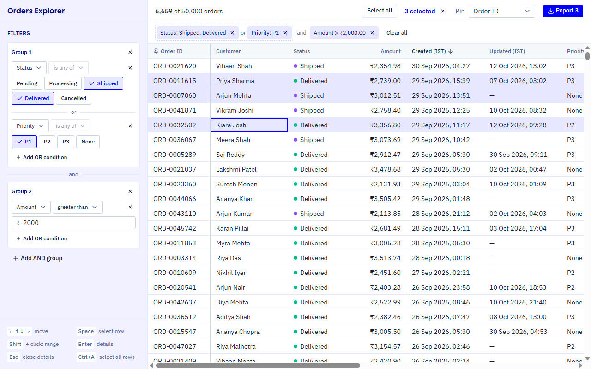
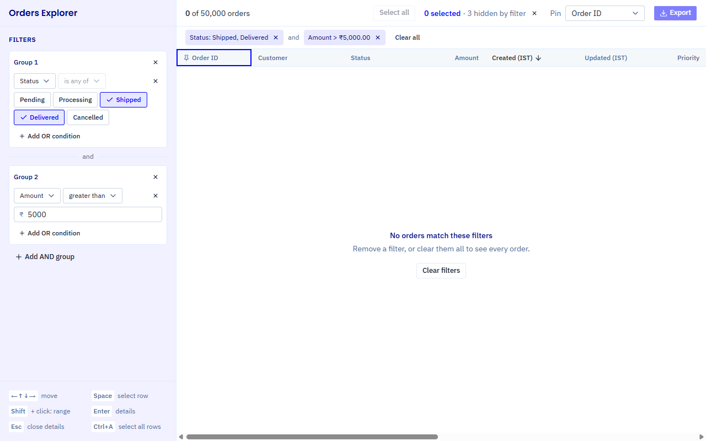
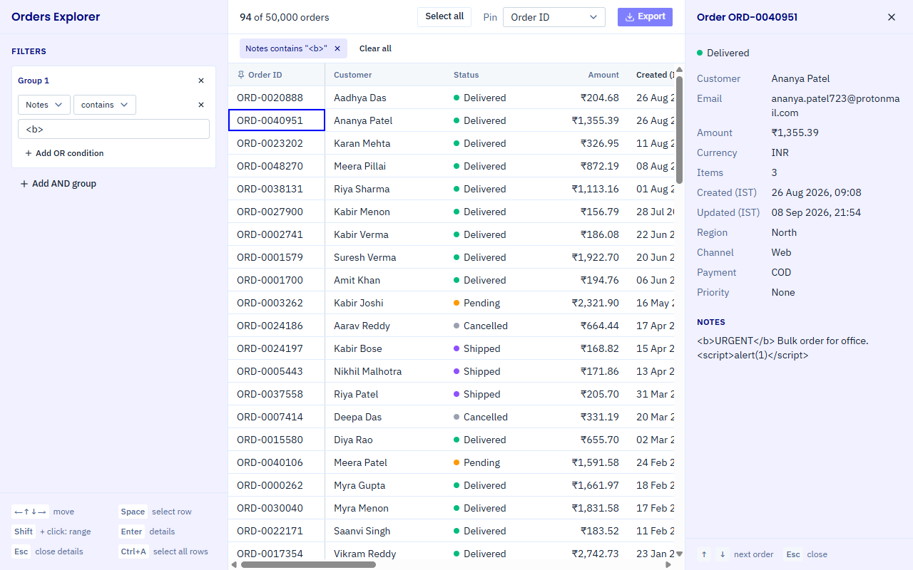

# Orders Explorer

One screen to browse and filter about 50,000 orders: a hand-built virtualized grid and a
hand-built filter builder, made with React, TypeScript and Vite.

## How to run

Needs Node 24 (see `.nvmrc`) and npm.

```bash
npm install
npm run dev
```

Then open http://localhost:5173.

- Production build: `npm run build`, then `npm run preview` (http://localhost:4173).
- `npm run typecheck` runs the TypeScript compiler and `npm run lint` runs Oxlint.

## Screenshots

Main screen: two filter groups, (Shipped OR Delivered OR P1) AND amount > ₹2,000, with three rows selected.



Empty state: the brief's own example, (Shipped OR Delivered) AND amount > ₹5,000, matches no order
(the largest amount in the file is ₹3,640.49). The three selected rows are hidden by the filter.



Row details: Enter (or a double-click) opens the order in a panel on the right, which follows ↑ / ↓. This
order's note contains HTML-like text from the data. As data-notes rule 9 asks, it is shown as plain text:
the `<b>` and `<script>` you see are just characters, so nothing turns bold and nothing runs.



## Dependencies

Runtime dependencies:

- `react`, `react-dom`: the UI.
- `radix-ui`: accessible building blocks behind the shadcn/ui controls (selects, toggle pills, the slide-in panel).
- `lucide-react`: the icons.
- `class-variance-authority`, `cn`: class-name helpers used by the shadcn/ui components.
- `shadcn`: the base styles of the shadcn/ui components (`shadcn/tailwind.css`).
- `tw-animate-css`: the small open and close animations of those components.
- `@fontsource-variable/ibm-plex-sans`, `@fontsource/poppins`: the fonts, served with the app.

None of them is a table, virtualization or filter-builder library: the grid and the filter builder are
written by hand. Vite, TypeScript, Tailwind CSS and Oxlint are build tools only.

## Data loading

- `public/orders.json` (17 MB) is fetched by a Web Worker (`src/workers/loadOrders.worker.ts`). The worker
  parses it, fixes every problem listed in `docs/data-notes.md` in one place (`src/utils/normalizeOrders.ts`),
  removes duplicate IDs (`src/utils/dedupeOrders.ts`) and sends the 50,000 clean orders to the page.
- Why a worker: doing the same work on the main thread froze the page for 188–348 ms when I measured it.
  With the worker, the longest main-thread task was 51–66 ms (when the orders arrive) and the loading
  spinner keeps moving.
- The file is not imported into the JavaScript bundle, so the app itself stays at 129 KB gzipped and the
  data loads on its own. There is no backend.

## The 200 rows question

- Export saves the selected rows that the current filter shows.
- Select 200 rows, then filter so 180 are hidden: Export saves the 20 you can see. The other 180 stay
  selected (the toolbar says "20 selected · 180 hidden by filter") and come back when the filter is
  cleared. The × next to the count clears all of them.
- Why: you export exactly what you can see and check, filtering never throws a selection away, and the
  count on screen is always the number of rows in the file, because both are made from the same list.

## Design changes

The app follows my sketches in `design/`: filter groups and keyboard hints in a left sidebar; toolbar,
chips bar and grid on the right; the details panel on the right. What changed:

- Styled after merklescience.com (colours, IBM Plex Sans and Poppins, 4 px corners) instead of plain boxes.
- Below 1024 px wide, the filter sidebar becomes a slide-in "Filters" panel and the details panel slides
  over the grid, so the app also works on tablets and phones. The sketches only cover a laptop screen.
- Added a Select all / Unselect all button next to the selection count (shortcut: Ctrl+A).
- Added an amber warning above the toolbar for links that can't be read.

## Known issues

- Column resizing works with a mouse or touch only, not the keyboard.
- Column widths are not kept in the link, so they reset on refresh (the brief's list of what goes in the
  URL doesn't include them).
- On my laptop running on battery, sorting all 50,000 rows or exporting all of them pauses the page for up
  to about 0.2 s, and a dropdown can take about 0.1 s to open.
- Selecting thousands of rows that are not next to each other makes a long link (about 29,000 characters
  for 5,000 rows picked in date order). It still works, because it sits after `#` and never reaches the
  server, but it is long to share.
- Dates are always shown and filtered in IST. There is no time-zone setting.

## Keyboard

- The grid is one Tab stop. Arrow keys move the focused cell; ↑ from the first row reaches the headers,
  where Enter or Space sorts.
- PageUp / PageDown, Home / End, Ctrl+Home / Ctrl+End jump around.
- Space selects or unselects the row; Shift+click selects a range.
- Ctrl+A (⌘A on a Mac) selects every row the filter shows, from anywhere on the page; pressing it again
  unselects them. Inside a text box it selects the typed text, as usual.
- Enter opens the details panel, which follows ↑ / ↓; Esc closes it.
- In the filter builder, adding a condition moves focus to its Field select, and the pills are one Tab
  stop (←/→ to move, Space to pick).

## Choices I made

- Dates are shown and filtered in IST (`14 Mar 2025, 09:30`). Zone-less ISO dates and `dd/mm/yyyy` are
  read as UTC, as the data notes say, so date-only records show 05:30.
- In a pair of duplicates with the same `updatedAt`, the later record in the file wins.
- Sorting: missing values (no update date, priority None, empty notes) always go last; Status sorts in
  workflow order (Pending → Cancelled); text ignores capital letters.
- Filters: text ignores capital letters and spaces around what you type; "between" includes both ends and
  works in either order; date conditions use whole IST days ("before" and "after" leave the chosen day out);
  an order that was never updated doesn't match an "Updated" condition.
- Links: the filter, sort, pinned column and selected rows live after `#`, for example
  `#group=status:anyOf:shipped,delivered&group=amount:greaterThan:2000&selected=2001-7000`. Selected rows
  are written as order-number ranges, so all 50,000 is `selected=1-50000`. A link that can't be read fully
  shows the warning and the default view.
- CSV: 14 columns in a fixed order (the grid's columns plus Currency), amounts as plain numbers, dates in
  IST as `2026-09-29 16:42:41`, so spreadsheets can sum and sort them. Text that starts like a formula
  (`=`, `+`, `-`, `@`) gets a leading `'`.

## Performance

Measured in Chrome on my laptop (Intel Core i5-1155G7, production build), plugged in → on battery:

- Rows on screen after 0.4 s → 1.5–2.2 s.
- 29–40 rows in the page at any time instead of 50,000; scrolling at 57–60 fps → 35 fps when flung very
  fast, never a blank row.
- Typing in a filter never blocks the page: the grid updates just after each key (`useDeferredValue`).
- An arrow key costs 2.5–5 ms of JavaScript; sorting 50,000 rows takes 56–200 ms.

## Code layout

- `src/components/`: React components, one per file (`ui/` holds the generated shadcn/ui files).
- `src/hooks/`: `useOrders`, `useVirtualRows`, `useGridKeyboard`, `useSelection`, `useUrlSync`.
- `src/utils/`: plain functions for cleaning, sorting, filtering, the URL and the CSV.
- `src/workers/`: the Web Worker that loads the orders. `src/types/`: shared types.
- `design/`: my sketches. `docs/`: the data notes and the screenshots.
